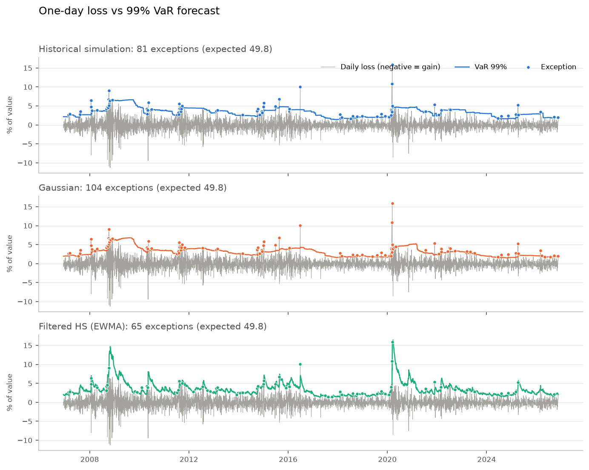

# VaR/ES backtesting

A small model validation exercise: one-day Value-at-Risk (VaR) and Expected Shortfall (ES) for an
equity portfolio, estimated with three methods and backtested on 20 years of daily data.
Methods and tests are written from scratch with `numpy` and `pandas` (`scipy` only for the normal
and chi-squared distributions and for `xlogy` in the zero-exception edge cases).

The goal is to become familiar with the concepts used in market risk model validation: VaR and ES,
historical and filtered historical simulation, EWMA volatility, and VaR backtesting (Kupiec, Christoffersen, Basel traffic light).

## Scope

- **Portfolio**: TotalEnergies, Deutsche Telekom, Santander, Nokia, Enel (`TTE.PA`, `DTE.DE`, `SAN.MC`,
  `NOKIA.HE`, `ENEL.MI`), buy-and-hold from equal initial weights, never rebalanced.
  The stocks were chosen ex ante, to avoid hindsight in the selection: going down the Euro Stoxx 50
  ranking by market capitalisation at the end of 2004, a stock is kept unless its country or its
  industry is already represented, until there are five (oil and gas, telecommunications, financials,
  technology, utilities). Companies delisted since then are skipped (see Limitations).
- **Measures**: one-day VaR at 99% and 97.5%, one-day ES at 97.5%.
- **Methods**: historical simulation (HS), Gaussian (variance-covariance), filtered historical simulation (FHS) with EWMA volatility per stock.
- **Backtests**: exception counts, Kupiec POF, Christoffersen independence and conditional
  coverage, Basel traffic light.

## Data

Daily adjusted close prices from Yahoo Finance, 2005-01-03 to 2026-11-19 (dividends reinvested).
Only dates on which all five exchanges traded are kept: 5,483 dates (131 dropped).
Daily moves larger than 15% were checked against market and company events: all are real, so no
price is corrected.

The returns show the two stylised facts the models must deal with:

| | TTE | DTE | SAN | NOKIA | ENEL | Portfolio |
|---|---|---|---|---|---|---|
| Excess kurtosis (fat tails) | 10.5 | 8.9 | 9.3 | 14.4 | 10.8 | 10.4 |
| Autocorrelation of r, lag 1 | 0.00 | -0.02 | 0.01 | 0.00 | -0.04 | -0.03 |
| Autocorrelation of r², lag 1 (volatility clustering) | 0.21 | 0.21 | 0.11 | 0.05 | 0.24 | 0.17 |

Returns are almost uncorrelated, but their squares are not (i.i.d. band ±0.026): volatility comes
in clusters.

## Method

| Item             | Choice                                                                        |
| ---------------- | ----------------------------------------------------------------------------- |
| Returns          | simple; loss `L_t = -r_t`                                                     |
| Weights          | `w_{i,t} = w_{i,t-1}(1+r_{i,t}) / Σ_j w_{j,t-1}(1+r_{j,t})`                   |
| Portfolio return | `r_{p,t} = Σ_i w_{i,t-1} r_{i,t}` (hypothetical P&L, positions frozen at t-1) |
| Window           | rolling 250 days; the forecast for day t uses data up to t-1 only             |
| Exception        | `L_t > VaR_t`                                                                 |
| Quantile         | `np.quantile`, default (linear) method                                        |

All methods apply the scenarios to the current weights `w_{t-1}`:

- **HS**: scenarios `X_s = Σ_i w_{i,t-1} r_{i,s}` for the 250 days s of the window; VaR is the
  empirical quantile of `-X_s`, ES the mean of the losses at or beyond VaR.
- **Gaussian**: mean μ and covariance Σ of the stock returns in the window, `μ_p = wᵀμ`,
  `σ_p = sqrt(wᵀΣw)`; `VaR = -μ_p + σ_p z_α`, `ES = -μ_p + σ_p φ(z_α)/(1-α)`, with α the confidence level, Φ and φ the standard normal CDF and density, and `z_α = Φ⁻¹(α)`.
- **FHS**: EWMA variance per stock, `σ²_{i,t} = λσ²_{i,t-1} + (1-λ)r²_{i,t-1}`, λ = 0.94, zero mean, started from the mean squared return of the first 250 days (burn-in). Residuals `z_{i,s} = r_{i,s}/σ_{i,s}`, with σ_{i,s} the same EWMA on day s (data up to s-1), are rescaled to today's volatility, `x_{i,s} = z_{i,s}σ_{i,t}`, taking all stocks on the same day s together to keep their correlation; then HS on `X_s = Σ_i w_{i,t-1} x_{i,s}`.

All methods are evaluated on the same 4,982 days (2006-12-11 to 2026-11-19), after the burn-in and the first window.

## Results

VaR and ES are reported as positive numbers, in % of portfolio value.

| Method   | Exceptions 99% (exp. 49.8) | p POF 99% | p cc 99% | Exceptions 97.5% (exp. 124.6) | p cc 97.5% | Mean VaR 99% | Mean ES 97.5% | Days yellow / red |
| -------- | -------------------------- | --------- | -------- | ----------------------------- | ---------- | ------------ | ------------- | ----------------- |
| HS       | 81                         | 0.000     | 0.000    | 166                           | 0.000      | 3.29%        | 3.48%         | 34.9% / 5.7%      |
| Gaussian | 104                        | 0.000     | 0.000    | 159                           | 0.000      | 3.03%        | 3.04%         | 28.5% / 15.5%     |
| FHS      | 65                         | 0.039     | 0.066    | 136                           | 0.478      | 3.42%        | 3.54%         | 24.0% / 0.0%      |

p POF = Kupiec proportion of failures (correct frequency, χ²(1)); p cc = Christoffersen conditional
coverage (correct frequency and independence, χ²(2)). Traffic light: exceptions of the 99% VaR in
the last 250 days (green 0-4, yellow 5-9, red ≥10), computed every day from the first full window.
A method is rejected when p cc < 0.05 (`reject_cc` in the script output).

`scripts/run_analysis.py` prints the full tables: final weights, statistics at lags 1, 5, 10,
forecast statistics, all test statistics, exceptions per year and the current zone.




## Conclusions

- **Gaussian: rejected.** Twice the expected 99% exceptions and 15.5% of days in the red zone.
  Thin tails underestimate extreme losses, and an equally weighted 250-day window reacts slowly (see figures).
- **HS: rejected.** Fat tails are in the data, but the window still reacts slowly: VaR jumps only
  after the losses and falls in steps about 250 days later, when they leave the window (from October 2009, see figures).
  Both methods have too many exceptions (Kupiec), and at 97.5% the exceptions also cluster
  (independence p = 0.005 for HS, 0.000 for Gaussian; at 99% p = 0.054 and 0.002).
- **FHS: not rejected (p cc above 0.05 at both levels), but borderline at 99%.** EWMA follows
  volatility clustering: the 99% VaR reached 16.4% in March 2020 (see figures), and the method is
  never in the red zone. At 99% Kupiec alone rejects (65 exceptions vs 49.8, p POF = 0.039), while
  conditional coverage does not (p cc = 0.066): its statistic adds the independence term, small here
  because the exceptions do not cluster (p ind = 0.280), and is compared with χ²(2) (5.99) instead of
  χ²(1) (3.84), so the same excess of exceptions weighs less. The price is a higher average VaR and a
  strongly procyclical risk number.
- ES 97.5% and VaR 99% are close under normality (2.338σ vs 2.326σ; Gaussian means 3.04% and 3.03%); FRTB uses ES 97.5% (MAR33.3) where Basel 2.5 used VaR 99%. With fat tails the gap is larger (HS 3.48% vs 3.29%, FHS 3.54% vs 3.42%).

## Limitations

- Survivorship: companies delisted during the sample cannot be selected; here this changed nothing,
  because the delisted candidates were already excluded by country or industry.
- One linear equity portfolio of five stocks; buy-and-hold lets the weights drift (TotalEnergies 30%,
  Nokia 5% at the last date); no cash flows.
- Hypothetical P&L with static positions, not actual P&L.

## Reproduce

```
pip install -r requirements.txt
python scripts/download_data.py   # downloads prices to data/ (not included in the repository)
python scripts/run_analysis.py    # prints the tables, writes figures/
```

Yahoo may revise past prices, so a new download can change the numbers slightly.

Code: `src/varbacktest/` (`data`, `portfolio`, `statistics`, `models`, `forecasting`, `backtest`, `plots`).
The first, function-based version, run on the original portfolio, is kept at the tag
[`v1-functional`](https://github.com/GiuseppeViola/var-es-backtest/tree/v1-functional).

## AI statement

This project was built with AI-assisted coding. Claude Code (Anthropic) acted as my tutor: it
explained the concepts and guided me through each step of the project.

## References

- J. Hull, *Options, Futures and Other Derivatives*.
- M. Pritsker (2001), *The Hidden Dangers of Historical Simulation*.
- S. D. Campbell (2005), *A Review of Backtesting and Backtesting Procedures*.
- Basel Committee, *Basel Framework*, MAR32, MAR33, MAR99.
