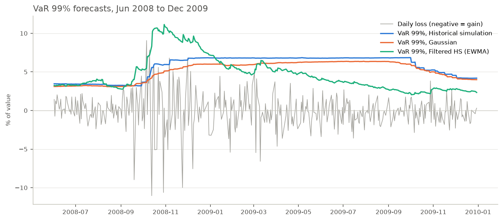
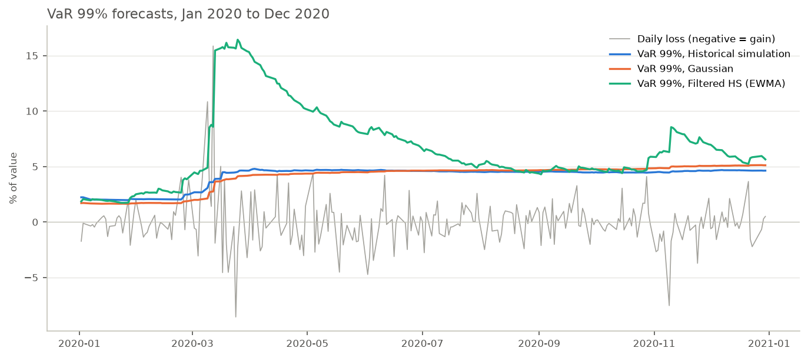
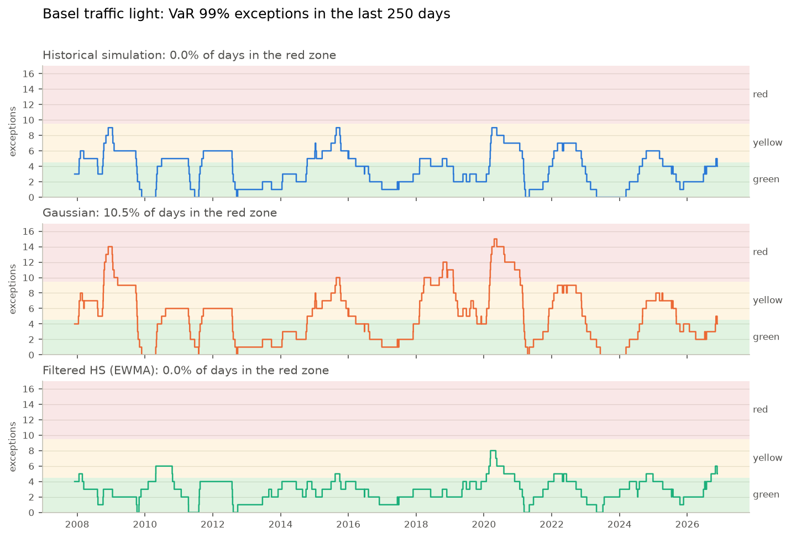

# VaR/ES backtesting

A small model validation exercise: one-day Value-at-Risk (VaR) and Expected Shortfall (ES) for an
equity portfolio, estimated with three methods and backtested on 20 years of daily data.
Methods and tests are written from scratch with `numpy` and `pandas` (`scipy` only for the normal
and chi-squared distributions and for `xlogy` in the zero-exception edge cases).

The goal is to become familiar with the concepts used in market risk model validation: VaR and ES,
historical and filtered historical simulation, EWMA volatility, and VaR backtesting (Kupiec, Christoffersen, Basel traffic light).

## Scope

- **Portfolio**: SAP, ASML, TotalEnergies, Santander, Enel (`SAP.DE`, `ASML.AS`, `TTE.PA`, `SAN.MC`,
  `ENEL.MI`), buy-and-hold from equal initial weights, never rebalanced.
- **Measures**: one-day VaR at 99% and 97.5%, one-day ES at 97.5%.
- **Methods**: historical simulation (HS), Gaussian (variance-covariance), filtered historical simulation (FHS) with EWMA volatility per stock.
- **Backtests**: exception counts, Kupiec POF, Christoffersen independence and conditional
  coverage, Basel traffic light.

## Data

Daily adjusted close prices from Yahoo Finance, 2005-01-03 to 2026-11-19 (dividends reinvested).
Only dates on which all five exchanges traded are kept: 5,549 dates (63 dropped).
One correction: ASML's 2012 synthetic share buyback (EUR 9.18 per share paid out with a 77:100 reverse split) is not adjusted by Yahoo and would show as a fictitious one-day loss; it is treated as a cash distribution reinvested in the stock.

The returns show the two stylised facts the models must deal with:

| | SAP | ASML | TTE | SAN | ENEL | Portfolio |
|---|---|---|---|---|---|---|
| Excess kurtosis (fat tails) | 14.8 | 3.4 | 10.7 | 8.9 | 10.9 | 4.9 |
| Autocorrelation of r, lag 1 | -0.01 | -0.01 | 0.00 | 0.01 | -0.03 | -0.02 |
| Autocorrelation of r², lag 1 (volatility clustering) | 0.07 | 0.08 | 0.21 | 0.11 | 0.24 | 0.11 |

Returns are almost uncorrelated, but their squares are not (i.i.d. band ±0.026): volatility comes
in clusters.

## Method

| Item             | Choice                                                                        |
| ---------------- | ----------------------------------------------------------------------------- |
| Returns          | simple; loss `L_t = -r_t`                                                     |
| Weights          | `w_{i,t} = w_{i,t-1}(1+r_{i,t}) / Σ_j w_{j,t-1}(1+r_{j,t})`                   |
| Portfolio return | `r_{p,t} = Σ_i w_{i,t-1} r_{i,t}` (hypothetical P&L, positions frozen at t-1) |
| Window           | rolling 250 days; the forecast for day t uses data up to t-1 only             |
| Exception        | `L_t > VaR_t`                                                                 |
| Quantile         | `np.quantile`, default (linear) method                                        |

All methods apply the scenarios to the current weights `w_{t-1}`:

- **HS**: scenarios `X_s = Σ_i w_{i,t-1} r_{i,s}` for the 250 days s of the window; VaR is the
  empirical quantile of `-X_s`, ES the mean of the losses at or beyond VaR.
- **Gaussian**: mean μ and covariance Σ of the stock returns in the window, `μ_p = wᵀμ`,
  `σ_p = sqrt(wᵀΣw)`; `VaR = -μ_p + σ_p z_α`, `ES = -μ_p + σ_p φ(z_α)/(1-α)`, with α the confidence level, Φ and φ the standard normal CDF and density, and `z_α = Φ⁻¹(α)`.
- **FHS**: EWMA variance per stock, `σ²_{i,t} = λσ²_{i,t-1} + (1-λ)r²_{i,t-1}`, λ = 0.94, zero mean, started from the mean squared return of the first 250 days (burn-in). Residuals `z_{i,s} = r_{i,s}/σ_{i,s}`, with σ_{i,s} the same EWMA on day s (data up to s-1), are rescaled to today's volatility, `x_{i,s} = z_{i,s}σ_{i,t}`, taking all stocks on the same day s together to keep their correlation; then HS on `X_s = Σ_i w_{i,t-1} x_{i,s}`.

All methods are evaluated on the same 5,048 days (2006-12-11 to 2026-11-19), after the burn-in and the first window.

## Results

VaR and ES are reported as positive numbers, in % of portfolio value.

| Method   | Exceptions 99% (exp. 50.5) | p POF 99% | p cc 99% | Exceptions 97.5% (exp. 126.2) | p cc 97.5% | Mean VaR 99% | Mean ES 97.5% | Days yellow / red |
| -------- | -------------------------- | --------- | -------- | ----------------------------- | ---------- | ------------ | ------------- | ----------------- |
| HS       | 74                         | 0.002     | 0.008    | 169                           | 0.000      | 4.04%        | 4.08%         | 40.3% / 0.0%      |
| Gaussian | 102                        | 0.000     | 0.000    | 165                           | 0.000      | 3.67%        | 3.68%         | 41.5% / 10.5%     |
| FHS      | 62                         | 0.116     | 0.280    | 144                           | 0.245      | 4.26%        | 4.40%         | 12.3% / 0.0%      |

p POF = Kupiec proportion of failures (correct frequency, χ²(1)); p cc = Christoffersen conditional
coverage (correct frequency and independence, χ²(2)). Traffic light: exceptions of the 99% VaR in
the last 250 days (green 0-4, yellow 5-9, red ≥10), computed every day from the first full window.
A method is rejected when p cc < 0.05 (`reject_cc` in the script output). `scripts/run_analysis.py` prints the full tables: final weights, statistics at lags 1, 5, 10,
forecast statistics, all test statistics, exceptions per year and the current zone.








## Conclusions

- **Gaussian: rejected.** Twice the expected 99% exceptions and 10.5% of days in the red zone.
  Thin tails underestimate extreme losses, and an equally weighted 250-day window reacts slowly (see figures).
- **HS: rejected.** Fat tails are in the data, but the window still reacts slowly: VaR jumps only
  after the losses and drops abruptly 250 days later, when they leave the window (October 2009, see figures).
  At 99% both rejections come from the frequency (Kupiec); at 97.5% the exceptions also cluster
  (independence p = 0.002 for HS, 0.000 for Gaussian).
- **FHS: p cc above 0.05** at both levels (0.280 and 0.245). EWMA follows volatility clustering:
  the 99% VaR reached 16.4% in March 2020 (see figures). The price is a higher average VaR and a strongly procyclical risk number.
- ES 97.5% and VaR 99% are close under normality (2.338σ vs 2.326σ; Gaussian means 3.68% and 3.67%); FRTB uses ES 97.5% (MAR33.3) where Basel 2.5 used VaR 99%. With fat tails the gap is larger (FHS 4.40% vs 4.26%).

## Limitations

- Survivorship bias: the stocks are today's large caps.
- One linear equity portfolio; buy-and-hold concentrates it in ASML (83% at the last date); no cash flows.
- Hypothetical P&L with static positions, not actual P&L.

## Reproduce

```
pip install -r requirements.txt
python scripts/download_data.py   # downloads prices to data/ (not included in the repository)
python scripts/run_analysis.py    # prints the tables, writes figures/
```

Yahoo may revise past prices, so a new download can change the numbers slightly.

Code: `src/varbacktest/` (`data`, `portfolio`, `statistics`, `models`, `forecasting`, `backtest`, `plots`).
The first, function-based version, run on the original portfolio, is kept at the tag
[`v1-functional`](https://github.com/GiuseppeViola/var-es-backtest/tree/v1-functional).

## AI statement

This project was built with AI-assisted coding. Claude Code (Anthropic) acted as my tutor: it
explained the concepts and guided me through each step of the project.

## References

- J. Hull, *Options, Futures and Other Derivatives*.
- M. Pritsker (2001), *The Hidden Dangers of Historical Simulation*.
- S. D. Campbell (2005), *A Review of Backtesting and Backtesting Procedures*.
- Basel Committee, *Basel Framework*, MAR32, MAR33, MAR99.
